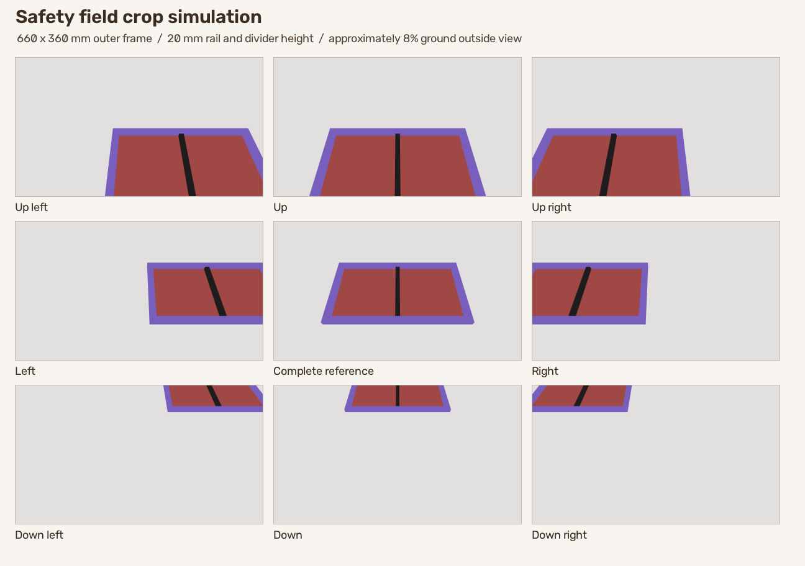

# 安全区测试（test/field）

使用 OpenCV 的纯核心测试，直接驱动 `FieldLocator::update`，不需要 ROS/TensorRT。
编译需要 C++17；从生产 YAML 生成参数头需要 Python 3 和 PyYAML。`corners` 模式只需要 C++ 编译器。

| 测试 | 内容 | 退出码 |
| --- | --- | --- |
| `test_field_matrix` | 单帧矩阵：干扰/视角/成像/物块网格/负例；每帧按中线可见性标为可判/边界/不可判 | 0 通过，1 有失败 |
| `test_field_sequence` | 序列：静止抖动与翻转、单/双帧注入后恢复、自动曝光爬坡与跳变；不测保持（属 bridge） | 0/1 |
| `test_field_replay` | 实拍回放：`data/<clip>/labels.yaml`，格式见 `data/README.md` | 无数据返回 77（跳过） |
| `test_field_colour` | 红/蓝分类、Lab 复用与逐像素判据一致，覆盖非连续 ROI 和向量尾部 | 0/1 |
| `test_corner_order` | 角点排列、窄长倾斜、透视和连续微扰 | 0/1 |
| `test_field_centers` | 半区真值与生产投影中心计算一致 | 0/1 |
| `test_field_truth` | 整侧出画、单角出画、贴线物块和完全遮挡的真值分类 | 0/1 |
| `test_field_split` | 高光、单侧贴线物块、不同内部颜色和遮挡负例的黑带识别 | 0/1 |
| `test_field_geometry` | 内沿独立采样、近边物理约束、背景粘连、不同输入尺寸及几何负例 | 0/1 |

## 运行

```bash
./run.sh                    # 全部；或 ./run.sh matrix --report [--filter 物块]
```

Windows：`.\run.ps1 matrix --report`；可用 `--case-index 0` 单独运行基线，避免终端中文参数编码差异。
筛选没有匹配任何场景时返回 2，不视为通过。
CMake 独立构建：`cmake -S . -B build && cmake --build build && ctest --test-dir build`。
板端 colcon：`colcon test --packages-select vision_pkg`（`BUILD_TESTING` 下由 vision_pkg 登记）。

## 八方向裁切模拟

`simulate_translation.py` 用针孔相机沿地面平移，覆盖四个直向和四个斜向。标准外框 660 × 360 mm，内框 600 × 300 mm，紫围栏高 20 mm，中央黑带为 300 × 20 × 20 mm。输出按地面度量的画外总面积，并单独估计左右红底的画外面积。需要 Python、OpenCV 和 NumPy。

```bash
python3 simulate_translation.py --output /tmp/field-crop
python3 simulate_translation.py --missing-fraction 0.20
python3 simulate_translation.py --planar --missing-fraction 0.20
```

原型以一张完整场地图像为参考，红色地面在 0 mm 平面匹配，紫围栏与黑带的顶面在 20 mm 平面匹配。随后使用三维场地模型把候选平移重投影到当前图像，核对紫框、红底和黑带的位置。匹配不唯一或黑带证据不足时撤销结果。模拟使用已知的相机内参和安装姿态，保持高度和朝向固定。现有 C++ 运行路径根据本帧可见边拟合，八向配准仅用于离线验证。



方向指相机的运动方向。画外面积以内场 1800 cm² 为基准，含黑带；扣除黑带后，两块红底各 870 cm²。中心误差取同一帧两个半区较大的误差，以 1280 × 720 处理图像素表示。

| 相机平移 | 约 8% 出画面积，真值 → 估计（cm²） | 中心误差（px） | 约 20% 出画面积，真值 → 估计（cm²） | 中心误差（px） |
| --- | ---: | ---: | ---: | ---: |
| 左 | 145.5 → 137.0 | 3.55 | 360.6 → 353.2 | 2.54 |
| 右 | 145.5 → 149.3 | 1.52 | 360.6 → 360.6 | 0.00 |
| 前 | 146.3 → 146.3 | 0.58 | 371.3 → 371.3 | 3.08 |
| 后 | 146.3 → 157.5 | 1.11 | 371.3 → 371.3 | 0.21 |
| 前左 | 153.0 → 152.1 | 2.43 | 372.4 → 371.2 | 2.13 |
| 前右 | 153.0 → 153.5 | 0.97 | 372.4 → 362.5 | 2.11 |
| 后左 | 148.4 → 169.7 | 3.83 | 360.1，拒绝补全 | — |
| 后右 | 148.4 → 170.3 | 2.54 | 360.1，拒绝补全 | — |

约 8% 出画时八向均能补全，最大面积误差为 21.9 cm²。约 20% 时六个方向通过，通过样本的最大面积误差为 9.9 cm²。纯背景和缺黑带样本均被拒绝。出画比例是本次样本的条件，实际有效范围取决于剩余的几何和颜色证据。

## 2026-11-17 验证结果

同批图像回放到 C++ 识别器，完整参考帧可输出正式分区，16 张裁切帧在冷启动和已有跟踪两种条件下均撤销正式分区。

| 主机检查 | 结果 |
| --- | --- |
| 新增紫框缺色专项 | 74 项通过，覆盖四边中段缺失 80%、远边及左右整边缺色、近边完全缺失的负例 |
| 40 mm 围栏压力矩阵 | 1158 项通过，4 项未达有效率门槛（高光压线、远视角、低对比、2 cm 黑块贴线） |
| 黑带专项 | 388 项通过，2 项运动模糊下的中线末端误差超限 |
| 几何专项 | 1158 项通过，1 项困难光照场景的有效率不足，含上述 74 项缺色检查 |
| 实拍回放 | 缺少标注数据，跳过 |

八向结果来自已知相机姿态的合成图。实际相机姿态误差、车辆转向和真实裁切场景仍待验证。

## 口径

- 算法参数（N、滤波系数、`field_max_fps`）由 `field_config.py` 从 rescue.yaml/rescue_advanced.yaml 生成，不写死；
  测试常量与阈值全部在 `scene_params.hpp`。
- 实物黑带宽度配置为 `vision.field.black_width_m: 0.020`（20 mm）；合成场景采用相同实测宽度，贴线物块位置按带宽和物块半宽计算。
- 中线可判性：有/无中线两次渲染差分得到看得见的中线像素，与只有相机几何和围边的干净场景比较，
  按米均匀采样计可见比例（整体与远/近三分之一段）。不可判的帧必须输出无效。
- 外框准确度：算法四条边在画内的采样点到真值内沿线（地面高度内边线）的平均距离；画外角点不计。
- 整条内沿完全出画时属于几何不完整，不能提交外框；只有单个角点出画而四条边仍可见时不作此降级。
- 紫框缺色回归覆盖四边中段 80% 缺失，以及远/左/右整边缺色。近边完全缺色且没有底缘证据时保留无效判定。传统合成矩阵继续用 40 mm 高的围栏作为遮挡压力样本。
- 半区中心按黑带中线划分，以对角线交点计算。矩阵对有效帧的左右中心平均误差执行原有 4 像素门槛。
- 计时只做本机相对比较：设 `FIELD_TIMING_REFERENCE_MS=<同机基线中位数>` 时检查不超过 1.2 倍；绝对值需板端。
- 生成器 `../host/field_scene.hpp` 的角点真值由 Jetson 端维护；本目录的内沿真值在 `visibility.hpp` 独立计算。

## 2026-11-15 本机验证

在 Windows / MinGW / OpenCV 4.13.0 上，以 20 mm 配置统一重编：连续帧、颜色分类、角点排序、中心真值、可见性真值、黑带和内沿几何专项均通过；实拍回放因没有带标注的片段返回 77。没有完成 Jetson NEON、ROS 节点集成或真实相机验收。

修复后的完整矩阵为 **1162 条通过、0 条失败**。原有场景、可判真值和精度门槛保持不变；几何专项 **1031 条**、黑带专项 **381 条**、原 host 颜色/场地测试 **131 条**均通过。新回归覆盖阴影几何证据、近沿真实采样、贴线黑块以及黑带完全遮挡的负例。

| 原失败场景 | 修复后结果 | 方法 |
| --- | --- | --- |
| 普通高光斑 | 可判帧有效 11/12，满足 90% 门槛 | 内部颜色网格扣除近侧围边遮挡，总红色占比仍按完整地面计算 |
| 55% 双阴影与梯度 | 内沿 0.49 px、中心 1.08 px | 严格紫色种子连接的暗部几何证据，保留色相和绝对色度要求 |
| 低对比 | 内沿 0.55 px、中心 0.94 px | 从实际 Lab 梯度定位物理内沿，避免二值阈值造成内缩 |
| 暗、低对比、模糊、杂物与白块组合 | 内沿 1.26 px、中心 1.76 px | 近沿实测约束与独立紫边采样联合拟合 |
| 黑块 3 cm 中部贴线、5 cm 近处/中部贴线 | 各 4/4 输出；中线均值约 0.32/0.29/0.29 px | 20 mm 先验限定搜索，另一侧仍须有真实弱边缘及整段黑带颜色证据 |

这些用例保留原来的失败判据，没有使用图像中线或历史几何代替本帧实测分界。完整矩阵桌面中位耗时 1.92 ms/帧，仅供该机器参考；真实曝光、颜色和运动仍需实车标定。实拍回放跳过不算实车验收通过。

另有原有边界：7 个红紫杂物的特定随机帧可能短暂提交诊断外框，但分区无效，`toFieldObservation` 不发布有效安全区目标。现有无场地负例及新增几何回归继续约束正式目标输出。
